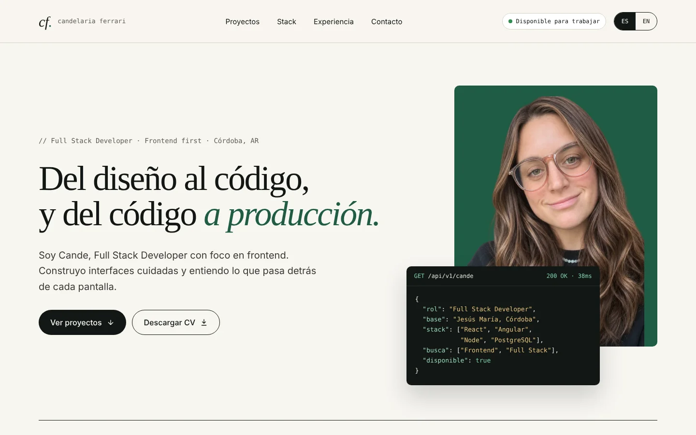

# Candelaria Ferrari · Portfolio

**Del diseño al código, y del código a producción.** Mi portfolio como Full Stack Developer con foco en frontend: proyectos de punta a punta, casos de estudio y cómo trabajo.

🔗 **Sitio:** [candelaria-ferrari.netlify.app](https://candelaria-ferrari.netlify.app/)



| | |
|---|---|
| **Stack** | React 19 · TypeScript · Vite · Tailwind CSS v4 |
| **Rutas** | React Router v7, con las páginas de caso de estudio cargadas bajo demanda |
| **Idiomas** | Español e inglés con i18next (siempre arranca en español) |
| **Animaciones** | Motion, respetando `prefers-reduced-motion` |
| **Deploy** | Netlify, con deploy automático desde `main` |

---

## Qué tiene

- **Proyectos de punta a punta.** Cada card marca qué capas hice yo y cuáles en equipo (UI, API, DB, Cloud), con links al deploy y al repo.
- **Casos de estudio** en `/proyectos/:slug`: qué hice, arquitectura, decisiones y pantallas, con capturas y videos que se amplían en un lightbox.
- **Diseño propio.** Diseñado en Figma y llevado a código con design tokens en Tailwind v4 (`@theme`): colores, tipografías y espaciados viven en un solo lugar.
- **Accesibilidad.** HTML semántico, foco visible, navegación por teclado en el lightbox (Esc y flechas) y textos alternativos en las capturas.
- **Responsive**, pensado para desktop y mobile.

## Estructura

```
src/
  pages/            → Home, CaseStudy, NotFound
  components/
    sections/       → secciones de la home (Hero, Proyectos, Stack, Experiencia, Contacto…)
    projects/       → cards, proyecto destacado, diagrama de arquitectura
    ui/             → piezas genéricas (botones, marcos, lightbox, badges)
    motion/         → variantes y componentes de animación
    layout/         → navbar y manejo del scroll
  data/             → proyectos, stack, contacto y capturas de cada caso de estudio
  i18n/locales/     → todos los textos, en es.ts y en.ts
  assets/           → foto y capturas de los proyectos
```

**Criterio:** el contenido está separado de los componentes. Los datos de cada proyecto viven en `src/data/` y los textos en `src/i18n/locales/`, así que sumar un proyecto no requiere tocar componentes.

## Cómo sumar un proyecto

1. Agregar el slug en `ProjectSlug` (`src/data/types.ts`).
2. Sumar el proyecto en `src/data/projects.ts`: capas, stack, links y tamaño de la card.
3. Escribir sus textos en `projects.items` de `es.ts` y `en.ts`.
4. Si tiene caso de estudio: poner `caseStudy: true`, sumar las capturas en `src/assets/projects/<slug>/`, crear `src/data/media/<slug>.ts` y escribir `caseStudy.items.<slug>` en los dos idiomas.

TypeScript avisa si falta un texto en alguno de los idiomas.

## Correr el proyecto

```bash
npm install
npm run dev       # servidor de desarrollo
npm run build     # chequeo de tipos + build de producción
npm run lint
```

## Contacto

📧 [ferrari.candelaria@gmail.com](mailto:ferrari.candelaria@gmail.com) · 💼 [LinkedIn](https://www.linkedin.com/in/candelariaferrari/) · 🐙 [GitHub](https://github.com/candelariaferrari)
